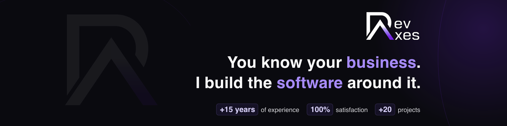
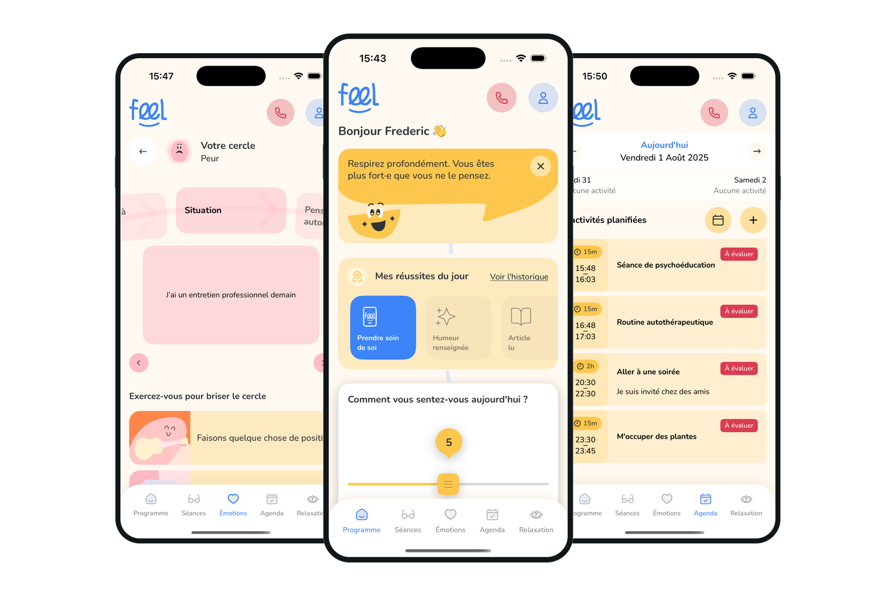
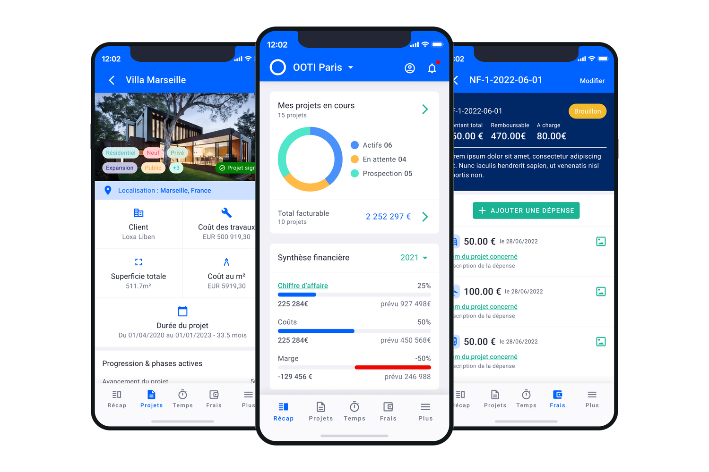
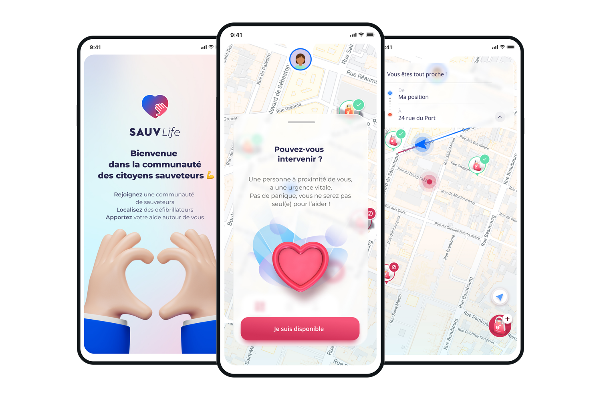
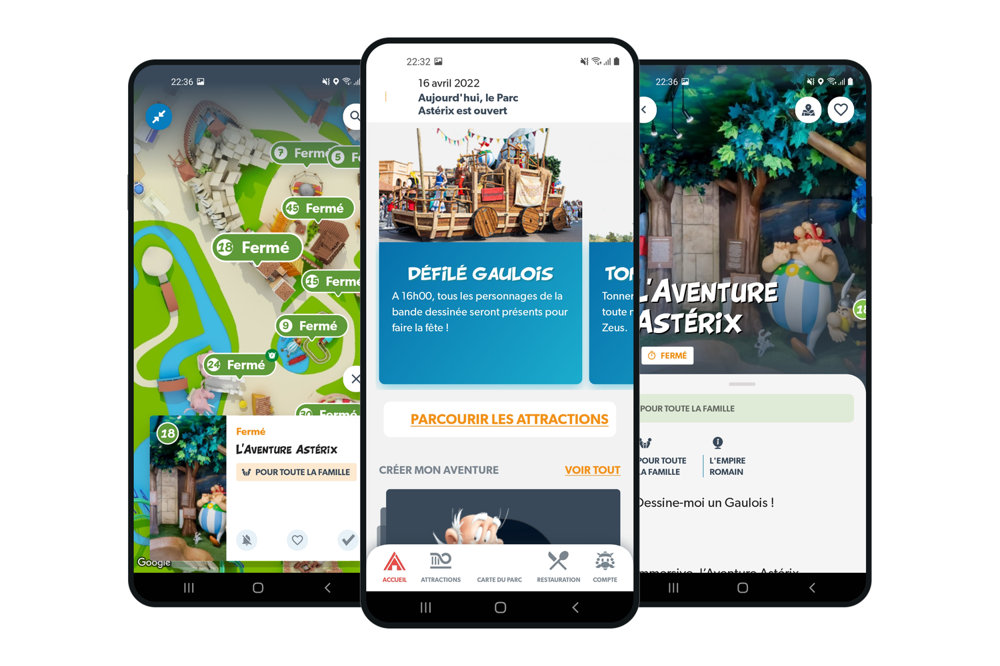
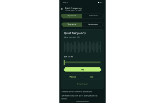
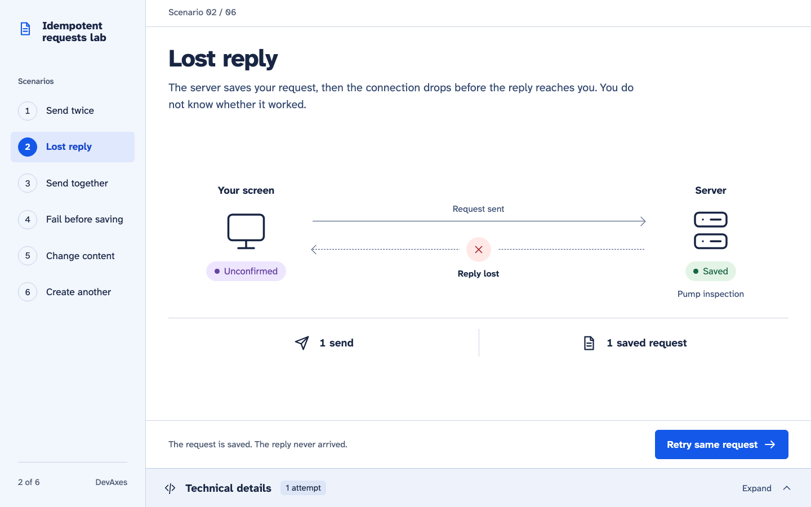
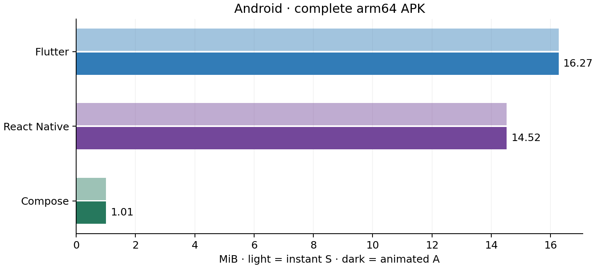

# Frédéric Raimondi

**Senior Mobile Developer** · Android / Kotlin · React Native / TypeScript

[devaxes.com](https://devaxes.com) · [LinkedIn](https://www.linkedin.com/in/freddev06/) · [Malt](https://www.malt.fr/profile/fredericraimondi)

## Work

Applications I have contributed to.

<strong><a href="projets/feel.md">Feel</a></strong> 
Mental health app. Mobile rebuild, technical leadership and Ruby on Rails backend. 
<code>React Native</code> <code>TypeScript</code> <code>Ruby on Rails</code>

 

---

<strong><a href="projets/ooti.md">OOTI</a></strong> 
Mobile apps for architecture firms: projects, time entries, expenses and approvals. 
<code>React Native</code> <code>TypeScript</code> <code>Redux/Saga</code>

 

---

<strong><a href="projets/sauvlife.md">Sauv’Life</a></strong> 
Mobile rebuild for volunteer responders, with geolocation and navigation. 
<code>React Native</code> <code>TypeScript</code> <code>Geolocation</code>

 

---

<strong><a href="projets/parc-asterix.md">Parc Astérix</a></strong> 
Visitor app with maps, attractions and food services. 
<code>React Native</code> <code>TypeScript</code> <code>GraphQL</code>

 

## DevAxes Labs

Personal experiments with public code and instructions to run them locally.

<strong><a href="https://github.com/FredDevAxes/compose-atlas">Compose Atlas</a></strong> 
Five interactive Android scenes to explore Jetpack Compose. 
<code>Kotlin</code> <code>Jetpack Compose</code> <code>v0.2.0</code> 
Offline lab with synthetic data.

 

---

<strong><a href="https://github.com/FredDevAxes/idempotent-requests-lab">Idempotent requests</a></strong> 
Recover a lost response without saving the same request twice. 
<code>NestJS</code> <code>PostgreSQL</code> <code>React</code> <code>v0.3.1</code> 
Local prototype; database transaction only.

 

---

<strong><a href="https://github.com/FredDevAxes/mobile-stack-benchmark">Mobile stack benchmark</a></strong> 
One catalogue across Flutter, React Native, Compose and SwiftUI. 
<code>v0.1.0-virtual-devices</code> 
Virtual-device milestone; no physical-device performance ranking.

 

