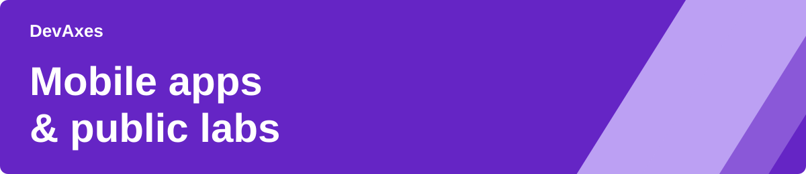
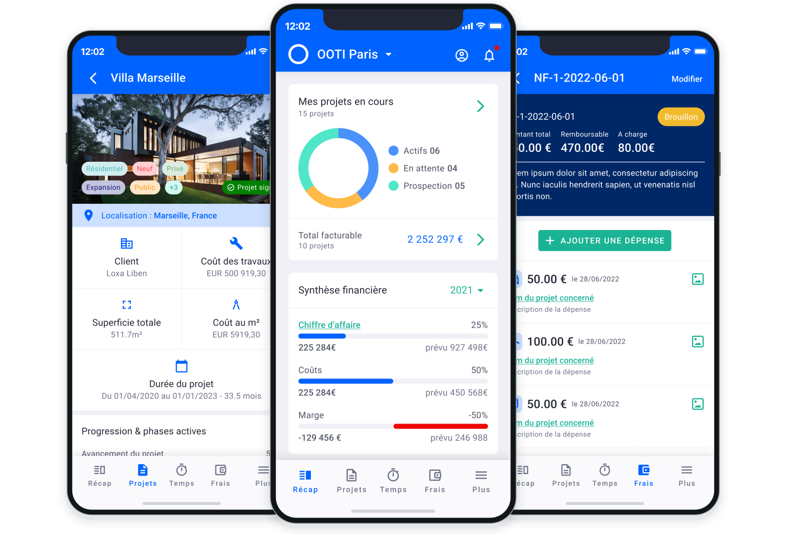

# Frédéric Raimondi

**Senior Mobile Developer**

Android / Kotlin · React Native / TypeScript

I build Android and iOS apps with Kotlin and React Native. I also take over existing products, from the codebase and backend to app store releases.

## Selected mobile work

### Feel

Feel is a mental health app for Android and iOS. As CTO / Full Stack Developer, I led the technical team, rebuilt the mobile apps and maintained the Ruby on Rails backend.

`React Native` `TypeScript` `Ruby on Rails` `PostgreSQL` `mobile and backend architecture` `technical leadership` `deployments`

---

### OOTI

I rebuilt OOTI's mobile apps for architecture firms, covering projects, time entries, expenses and approvals.

`React Native` `TypeScript` `Redux/Saga` `REST API` `mobile CI/CD`

---

<a href="projets/README.md">All mobile projects</a>

---

## DevAxes Labs

These are personal experiments with public code and instructions to run them locally.

### Idempotent requests

**v0.3.1 · Local prototype**

A request is saved, but its response is lost. This lab shows how a retry can recover it without creating a second request.

`NestJS` `PostgreSQL` `React` `TypeScript`

---

### Mobile stack benchmark

**In progress**

The same catalogue in Flutter, React Native, Jetpack Compose and SwiftUI, with and without an animated transition.

`Flutter` `React Native` `Kotlin / Compose` `Swift / SwiftUI`

---

<a href="labs/README.md">All labs</a>

---

[devaxes.com](https://devaxes.com) · [LinkedIn](https://www.linkedin.com/in/freddev06/)
