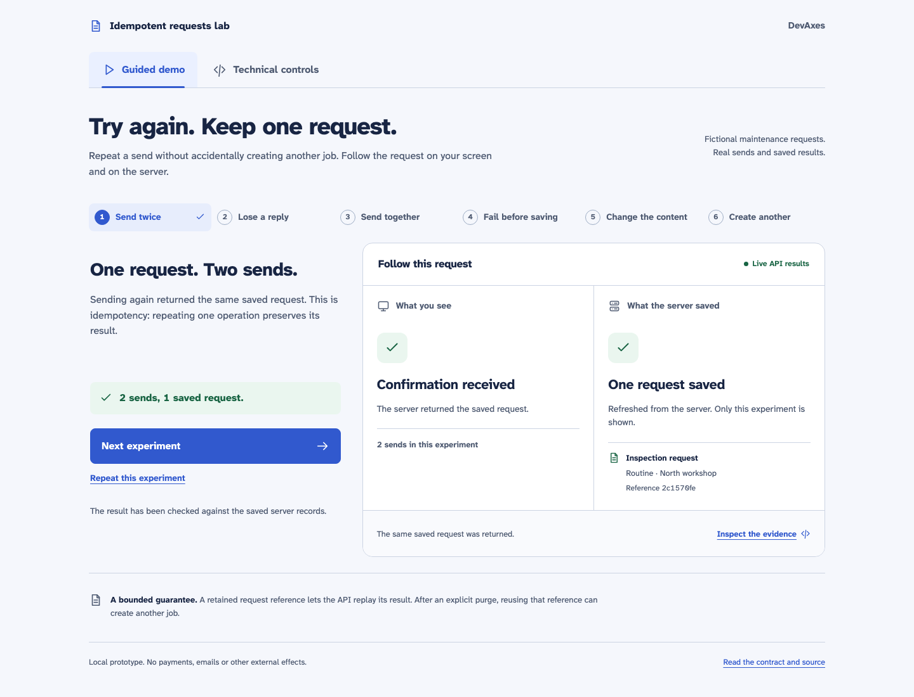
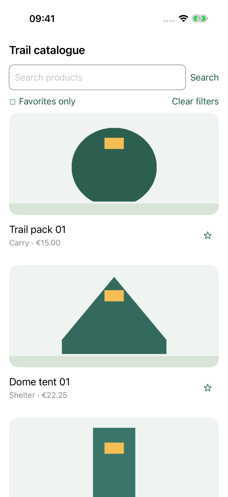

# DevAxes Labs

Small projects where I explore a specific technical question. Each lab has its own public repository.

## Idempotent requests

**v0.2.0 · Local prototype**

A request is saved, but its response is lost. This lab shows how a retry can recover it without creating a second request.

NestJS · PostgreSQL · React · TypeScript

---

## Mobile stack benchmark

**In progress**

The same catalogue in Flutter, React Native, Jetpack Compose and SwiftUI, with and without an animated transition.

Flutter · React Native · Kotlin / Compose · Swift / SwiftUI

---

