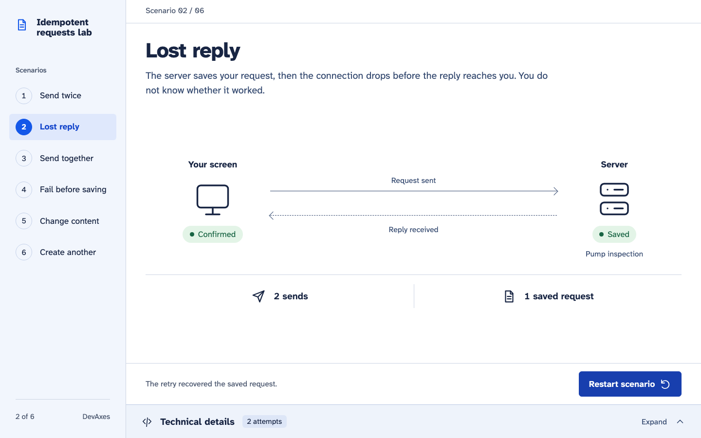

# DevAxes Labs

Small projects where I explore a specific technical question. Each lab has its own public repository.

## Idempotent requests

**v0.3.1 · Local prototype**

A request is saved, but its response is lost. This lab shows how a retry can recover it without creating a second request.

`NestJS` `PostgreSQL` `React` `TypeScript`

Six guided scenarios compare what the client knows with what PostgreSQL saved: repeated sends, a lost reply, twenty concurrent attempts, a failure before saving, changed content under the same reference, and a separate request. Expand Technical details to inspect real HTTP attempts, saved records and request keys.

The client keeps the same key and content across retries and reloads. While the key is retained, the API returns the recorded result; after explicit purge, reusing it can create another request. This local prototype uses fictional maintenance data. Its guarantee covers the database transaction, with no payments, emails or other external effects.

Retrying the same request recovers its confirmation: two sends, one saved request.

[Visual tour and recording](https://github.com/FredDevAxes/idempotent-requests-lab/blob/main/docs/visual-tour.md) · [Demo protocol](https://github.com/FredDevAxes/idempotent-requests-lab/blob/main/docs/demo.md) · [API contract](https://github.com/FredDevAxes/idempotent-requests-lab/blob/main/docs/contract.md)

---

## Mobile stack benchmark

**In progress**

The same catalogue in Flutter, React Native, Jetpack Compose and SwiftUI, with and without an animated transition.

`Flutter` `React Native` `Kotlin / Compose` `Swift / SwiftUI`

---

<a href="../projets/README.md">All mobile projects</a>

