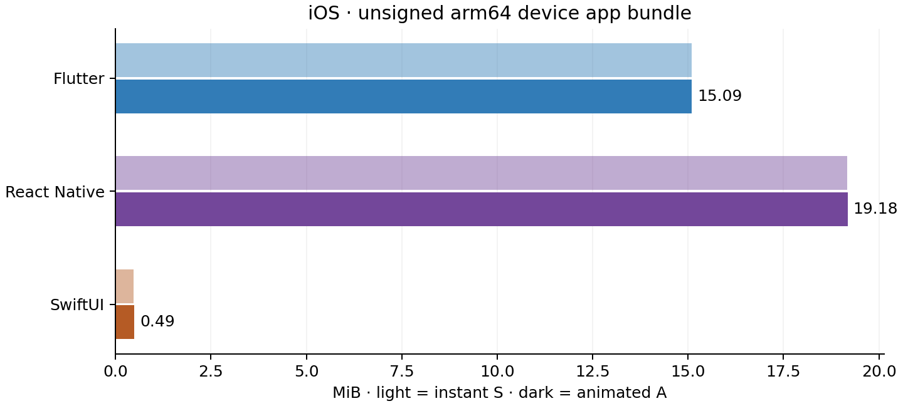

# DevAxes Labs

Small projects where I explore a specific technical question. Each lab has its own public repository.

## Idempotent requests

**v0.3.1 · Local prototype**

A request is saved, but its response is lost. This lab shows how a retry can recover it without creating a second request.

`NestJS` `PostgreSQL` `React` `TypeScript`

Six guided scenarios compare what the client knows with what PostgreSQL saved: repeated sends, a lost reply, twenty concurrent attempts, a failure before saving, changed content under the same reference, and a separate request. Expand Technical details to inspect real HTTP attempts, saved records and request keys.

The client keeps the same key and content across retries and reloads. While the key is retained, the API returns the recorded result; after explicit purge, reusing it can create another request. This local prototype uses fictional maintenance data. Its guarantee covers the database transaction, with no payments, emails or other external effects.

Retrying the same request recovers its confirmation: two sends, one saved request.

[Visual tour and recording](https://github.com/FredDevAxes/idempotent-requests-lab/blob/main/docs/visual-tour.md) · [Demo protocol](https://github.com/FredDevAxes/idempotent-requests-lab/blob/main/docs/demo.md) · [API contract](https://github.com/FredDevAxes/idempotent-requests-lab/blob/main/docs/contract.md)

---

## Mobile stack benchmark

Android Release arm64 APK sizes for this catalogue. S uses instant navigation; A adds an animated transition. These are package sizes, not store downloads or installed footprints.

**v0.1.0-virtual-devices · Virtual-device milestone complete**

The same catalogue in Flutter, React Native, Jetpack Compose and SwiftUI, with and without an animated transition.

`Flutter` `React Native` `Kotlin / Compose` `Swift / SwiftUI`

Four implementations cover six Android and iOS targets, sharing 200 fictional hiking products and 20 original illustrations. Each app supports search, persistent favourites and a return to the same position in the catalogue.

S uses instant navigation; A moves the product image into its detail over a programmed 400 ms. The verified report records Release package sizes, maintained source counts, 54 functional and visual flows, and 30 fixed transition stages. The Android and iOS videos show the three apps on each platform; their gestures are not synchronized timing measurements.

The first milestone uses an Android emulator and an iOS simulator. Physical-device fluidity, startup and memory comparisons have not been performed. Flutter runs in Debug on the tested iOS simulator, so there is no common iOS performance ranking. Package sizes and line counts describe this catalogue, not development time, code quality or a universally best stack.

iOS sizes measure unsigned arm64 device Release app bundles. Compare stacks within each platform; Android APK and iOS bundle sizes use different formats.

[Reports and use cases](https://github.com/FredDevAxes/mobile-stack-benchmark/blob/main/docs/reports/README.md) · [Verified report and visual comparisons](https://github.com/FredDevAxes/mobile-stack-benchmark/blob/v0.1.0-virtual-devices/results/REPORT.md) · [Reproduction guide](https://github.com/FredDevAxes/mobile-stack-benchmark/blob/main/docs/REPRODUCE.md) · [Android video](https://github.com/FredDevAxes/mobile-stack-benchmark/blob/v0.1.0-virtual-devices/results/visuals/android/comparison.mp4) · [iOS video](https://github.com/FredDevAxes/mobile-stack-benchmark/blob/v0.1.0-virtual-devices/results/visuals/ios/comparison.mp4)

---

<a href="../projets/README.md">All mobile projects</a>

