[Back to profile](../README.md) · [All labs](README.md)

# Compose Atlas

**v0.3.0 · Eight working Android experiences**

Fold a record player, follow a parcel, make a ticket or rearrange a morning. Eight familiar app moments show Jetpack Compose patterns through working interfaces and a How it works explanation.

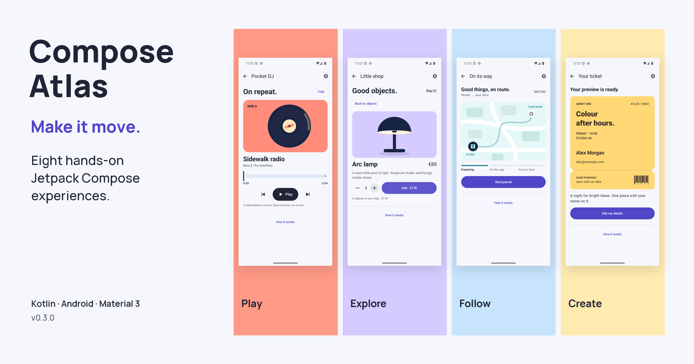

Native Android interfaces with fictional local data and original geometric artwork.

`Kotlin` `Jetpack Compose` `Canvas` `Animation` `Gestures` `UI testing`

Each scene starts with a task you can try. Fold the silent player, keep an object in view from shop to detail, follow a parcel along a drawn route, inspect a chart, create a local ticket preview, transform a poster, undo an archived message or make space in an agenda.

How it works explains the Compose mechanism, a real application and the boundary of each demonstration. One shared motion preference offers Normal, Slow motion and Off; light and dark themes follow the system.

This MIT lab runs offline with fictional data and no account or backend. The player has no audio engine; the shop charges nothing; no parcel, email or ticket is sent. Local checks passed six unit tests and eleven instrumented tests. Hosted check results are linked in the verification record. Emulator checks do not establish physical-device performance or accessibility certification.

[Visual tour](https://github.com/FredDevAxes/compose-atlas/blob/main/docs/visual-tour.md) · [Run locally](https://github.com/FredDevAxes/compose-atlas#run-locally) · [Capability map](https://github.com/FredDevAxes/compose-atlas/blob/main/docs/coverage.md) · [Verification record](https://github.com/FredDevAxes/compose-atlas/blob/main/docs/verification.md)

## Gallery

### Start with something familiar

Choose among eight working interfaces from the gallery.

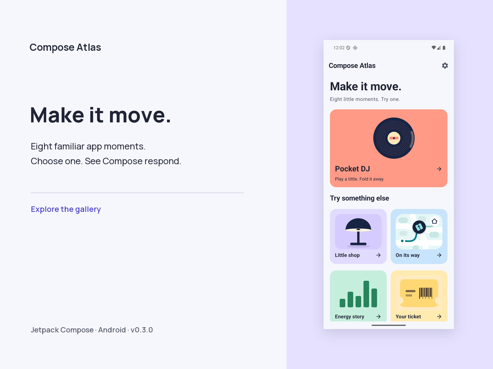

### Pocket DJ

Play, seek, change tracks and fold the sleeve. Playback is simulated and silent.

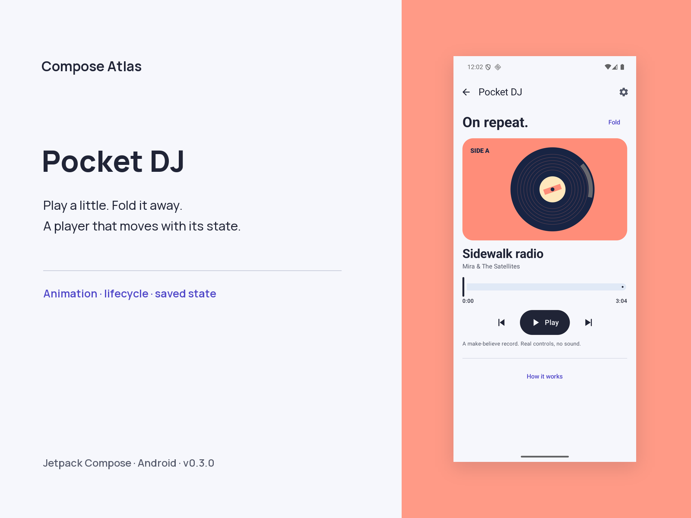

### Little shop

Open an object, change quantity and add it to the local demo bag. Shared elements preserve its identity.

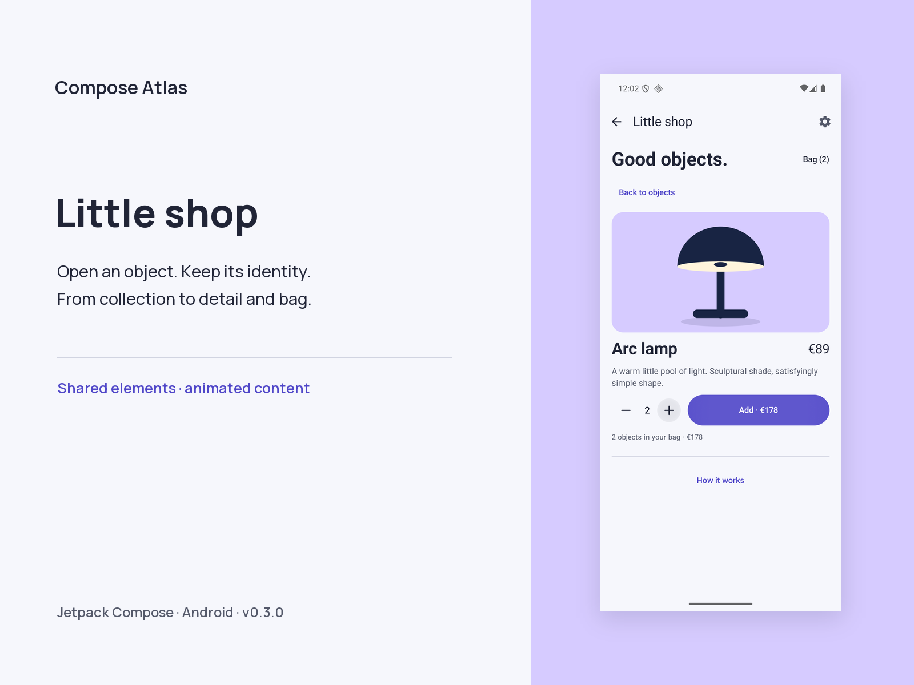

### On its way

Follow a fictional parcel along a drawn route, then replay its progress.

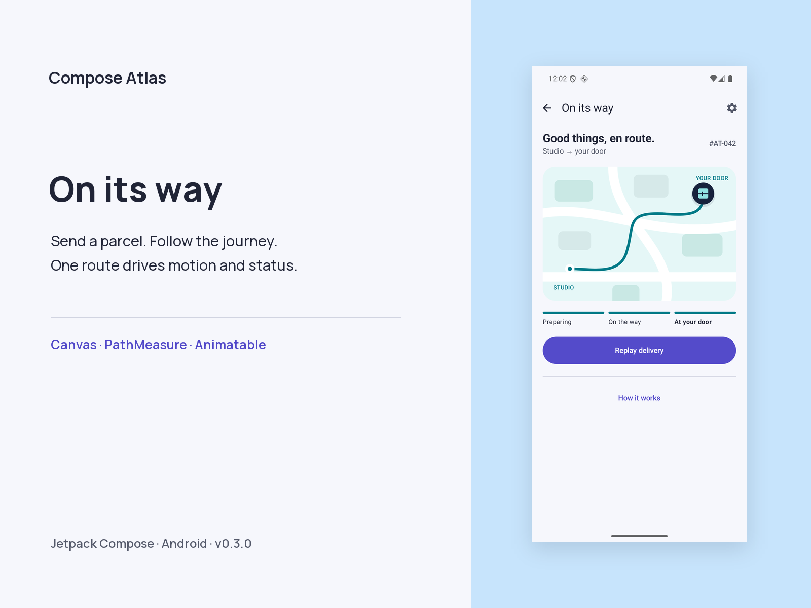

### Energy story

Inspect the evening peak and the missing noon reading by touch or with equivalent buttons.

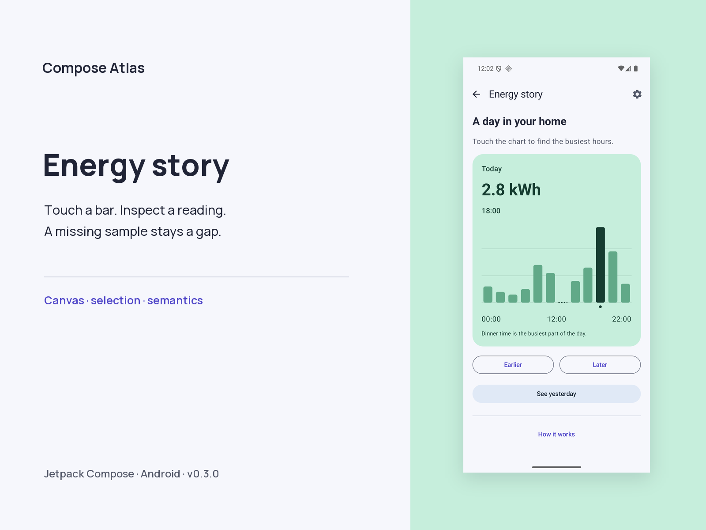

### Your ticket

Validate a name and email, then create a local ticket preview. Nothing is submitted.

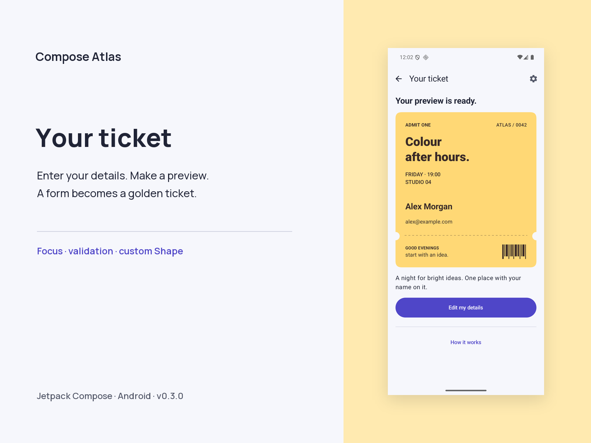

### Poster studio

Pinch, rotate and drag original artwork, or use the equivalent zoom and rotation controls.

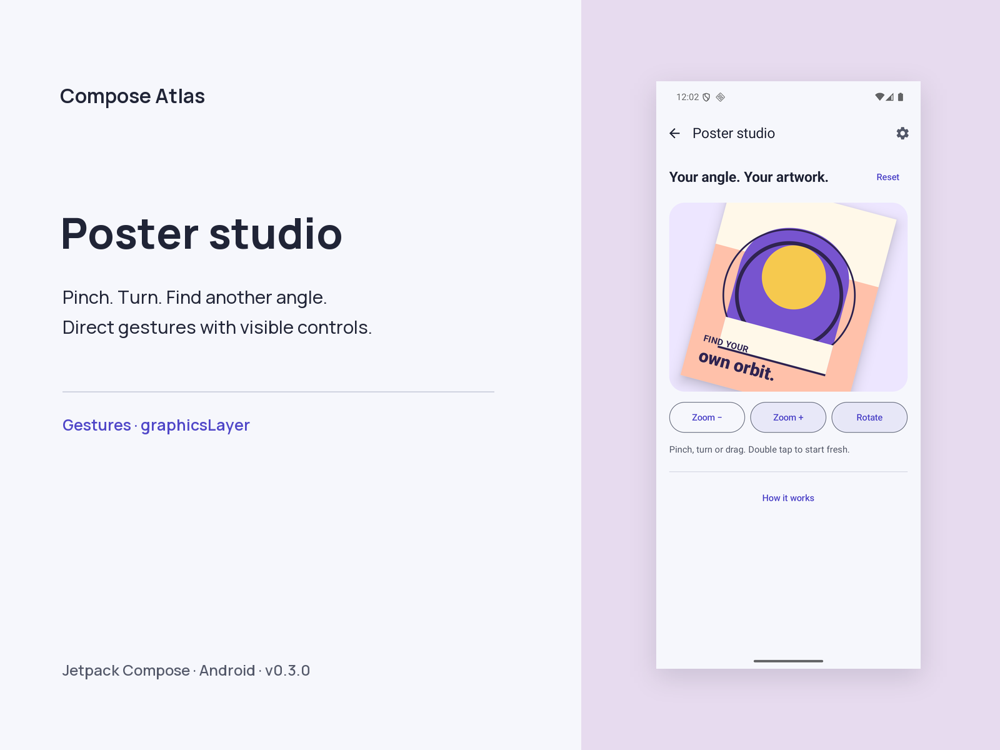

### Inbox zero

Archive a message, undo it or clear the inbox. Stable identity keeps the moving rows consistent.

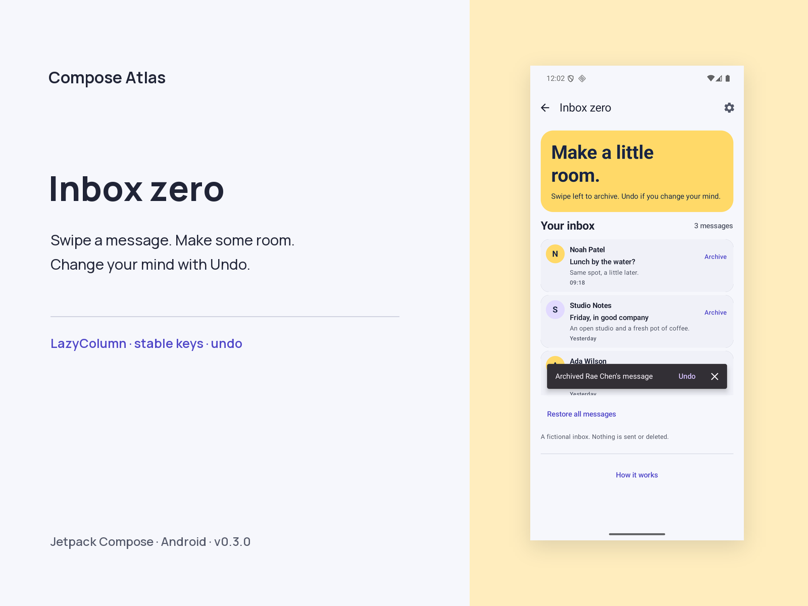

### Make room

Move coffee to 11:00 and watch the overlap lanes make space. Enlarged text reveals a chronological list.

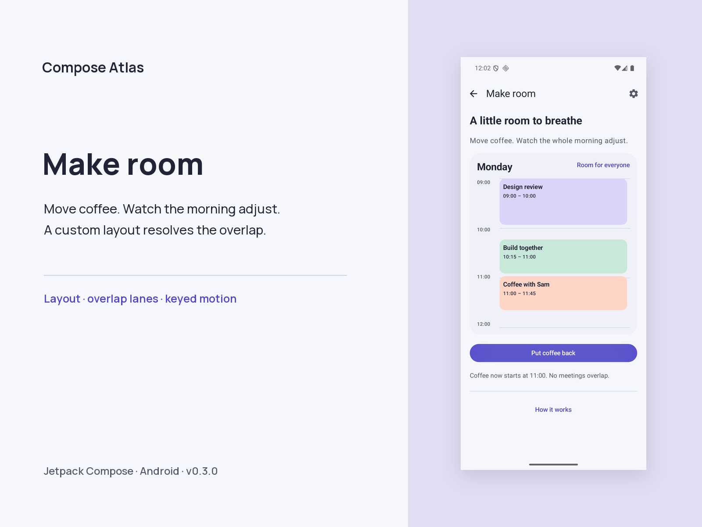

### One motion preference

Compare Normal, Slow motion and Off across the scenes. Android animation settings still apply.

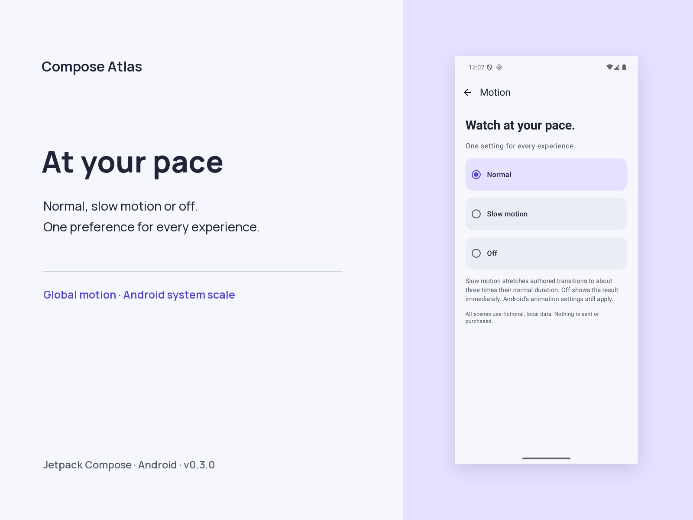

### Read what made it work

Every scene explains its mechanism, a production use case and the limits of the simulation.

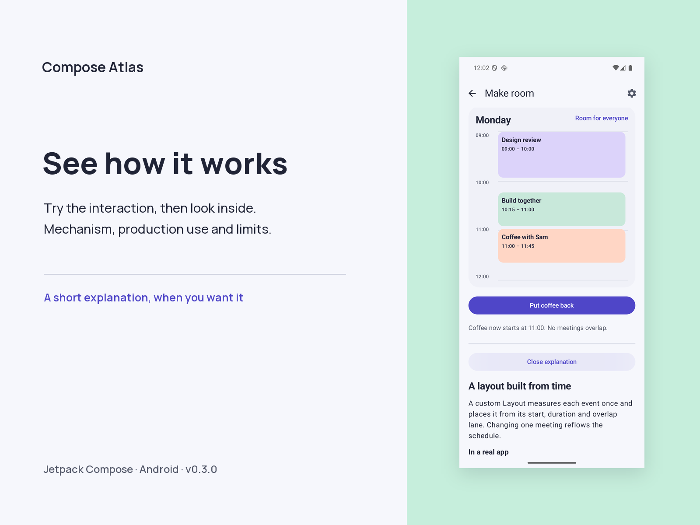

---

[devaxes.com](https://devaxes.com) · [LinkedIn](https://www.linkedin.com/in/freddev06/)
