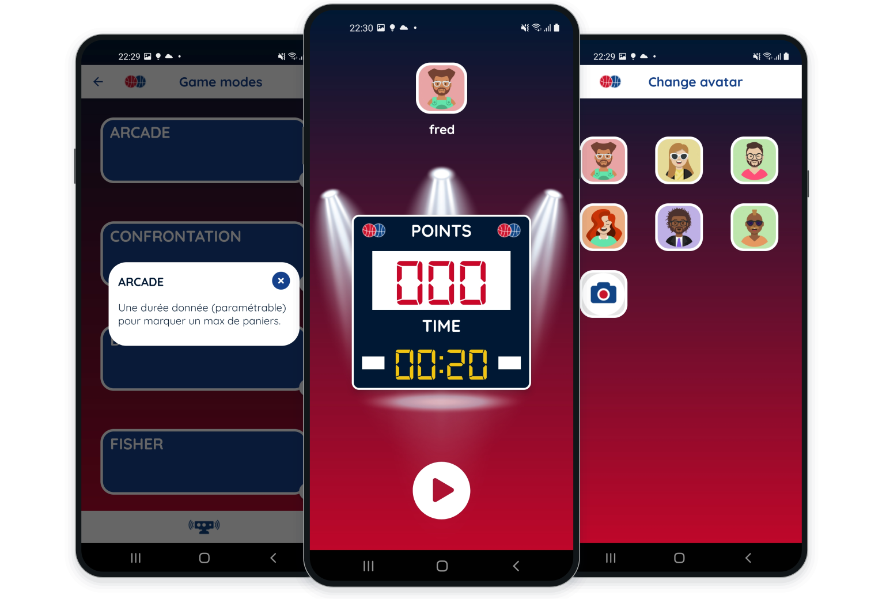
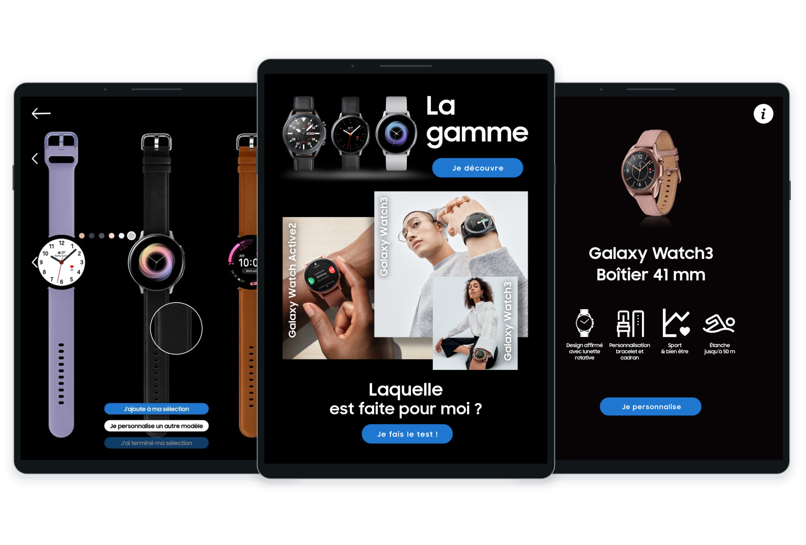
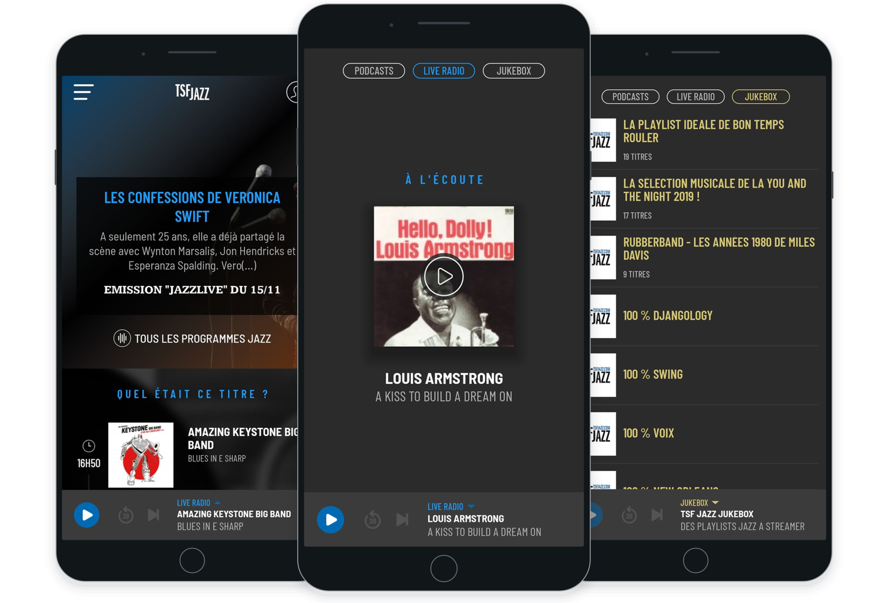
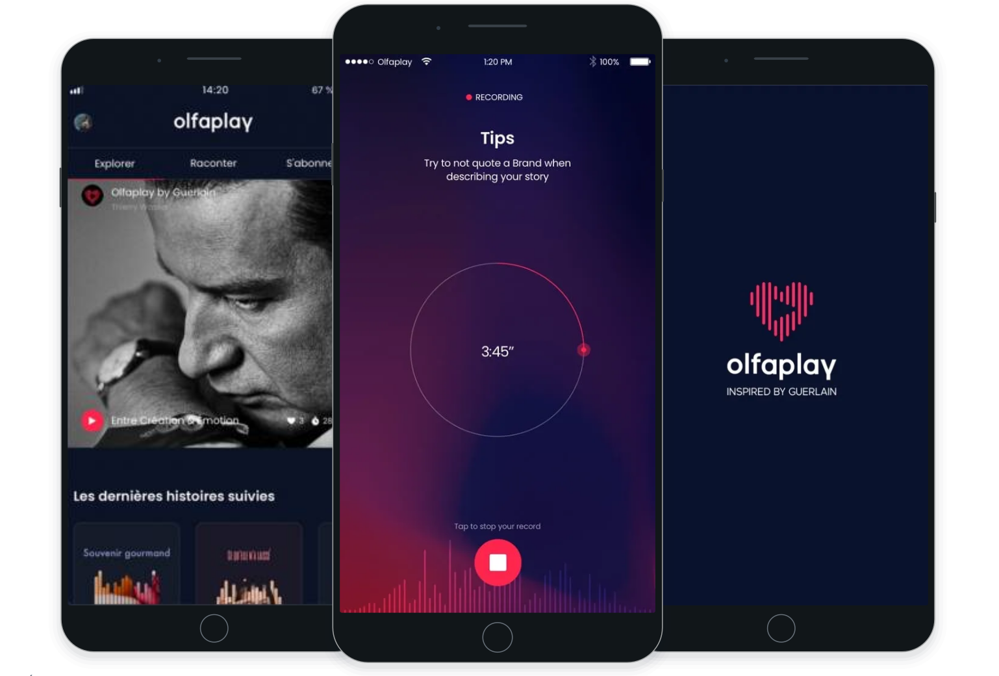
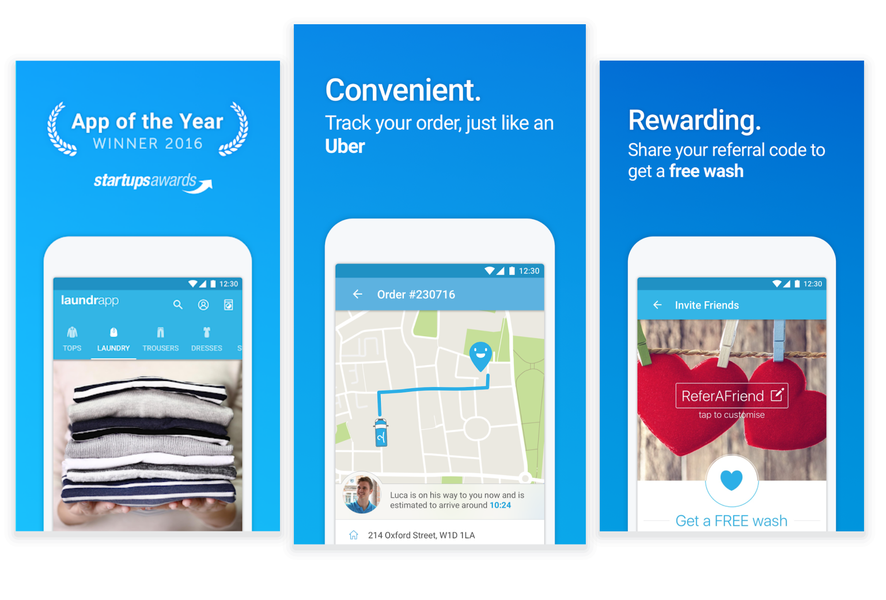

# Mobile projects

Android and iOS applications I have worked on, with my role and the technologies involved.

### Feel

Feel is a mental health app for Android and iOS. As CTO / Full Stack Developer, I led the technical team, rebuilt the mobile apps and maintained the Ruby on Rails backend.

`React Native` `TypeScript` `Ruby on Rails` `PostgreSQL` `mobile and backend architecture` `technical leadership` `deployments`

---

### OOTI

I rebuilt OOTI's mobile apps for architecture firms, covering projects, time entries, expenses and approvals.

`React Native` `TypeScript` `Redux/Saga` `REST API` `mobile CI/CD`

---

### Sauv'Life

Android/iOS mobile rebuild engagement for Sauv’Life, an app for volunteer responders alerted by French emergency medical services (SAMU). Geolocation, navigation and degraded networks.

`React Native` `TypeScript` `geolocation` `WebRTC` `operation on degraded networks`

---

### Application Parc Astérix

Maintenance and development of the official Parc Astérix iOS and Android app: map, search, attractions and food services, in React Native.

`React Native` `TypeScript` `GraphQL` `mobile mapping` `Firebase`

---

### GameTime

Android time-management app for board games, with Bluetooth synchronisation and game recovery. Delivered and distributed within a private circle, outside the app stores.

`Kotlin` `Android` `Bluetooth` `MVVM` `Room`

---

### Hoop Hook

Connected basketball Android app delivered to the client. Bluetooth connection to the sensor, state monitoring and several game modes.

`Kotlin` `Android` `Bluetooth Low Energy` `Hilt` `Firebase`

---

### OOPET Love

Social Android app for pet owners: profiles, messaging, and photo and video sharing, based on a Kotlin foundation shared with OOPET Lost.

`Kotlin` `Android Jetpack` `mobile messaging` `media management` `Firebase`

---

### Samsung Watch Retail

Galaxy Watch Android demonstration app on an in-store kiosk, with kiosk mode and reset between visitors. Project carried out as subcontracting work.

`Kotlin` `Android` `kiosk mode` `session reset` `kiosk integration`

---

### TSF Jazz

React Native mobile development for the TSF Jazz app: live radio, podcasts, themed streams and editorial content on iOS and Android.

`React Native` `iOS` `Android` `audio streaming` `media player`

---

### ECNAudio

ECNAudio prepared medical students for the French national ranking examinations. I developed the React Native app: audio lessons, downloadable notes and offline listening.

`React Native` `mobile development` `audio playback` `offline downloading` `background playback`

---

### Olfaplay

Contribution to the mobile apps for Olfaplay, Guerlain's audio platform: story recording, streaming and moderation. Work through Big Boss Studio.

`mobile development` `iOS` `Android` `audio recording` `audio streaming`

---

### Laundrapp

On-demand laundry Android apps: maintenance of the customer app and creation of the courier app, with routes and location tracking.

`Android` `Java` `Google Maps` `NFC provisioning` `mobile CI/CD`

---

### Anaca3 - Scan minceur

  

Maintenance of the Anaca3 mobile app at Big Boss Studio. The product let users scan a food item and view a score and alternatives.

`mobile app maintenance`

## Earlier projects and mobile tooling

### Kréa

Lead development of the C#/.NET Kréa desktop editor and its Lua generation engine for Corona SDK mobile projects.

`C#/.NET` `WPF` `Lua` `code generation` `Corona SDK`

---

<a href="../labs/README.md">All labs</a>

