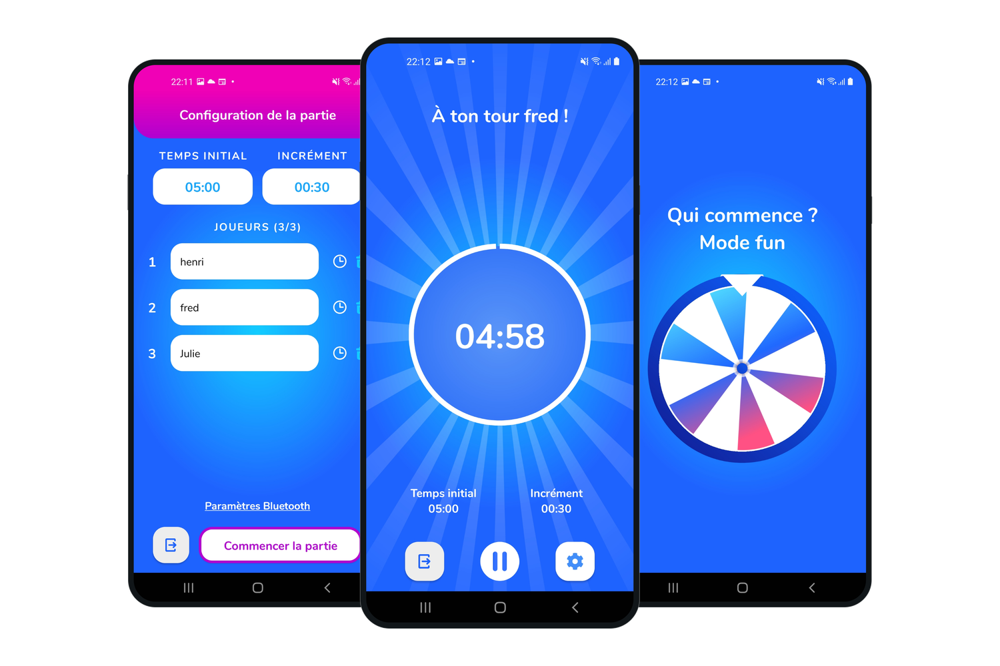
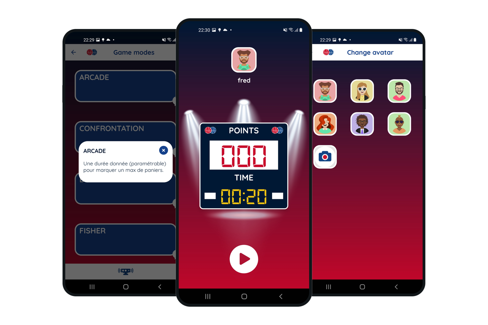
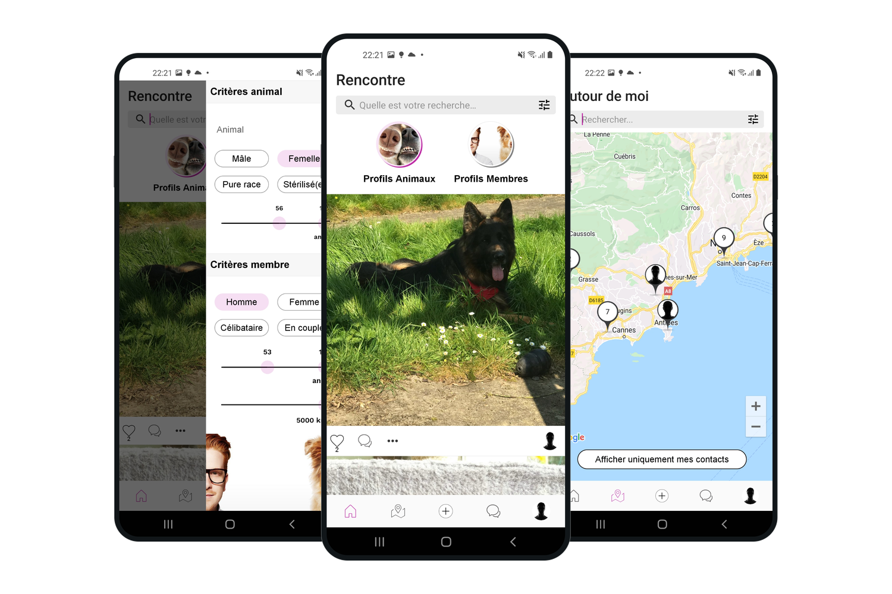
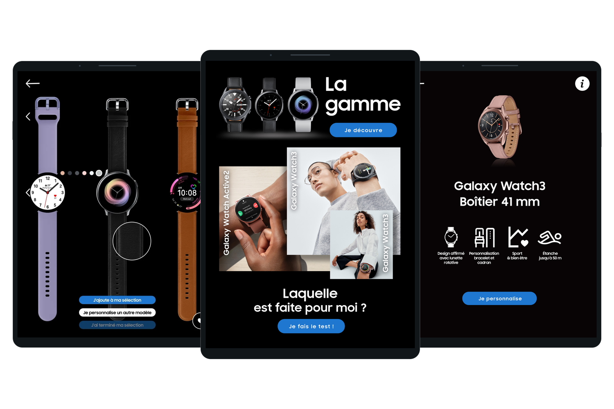
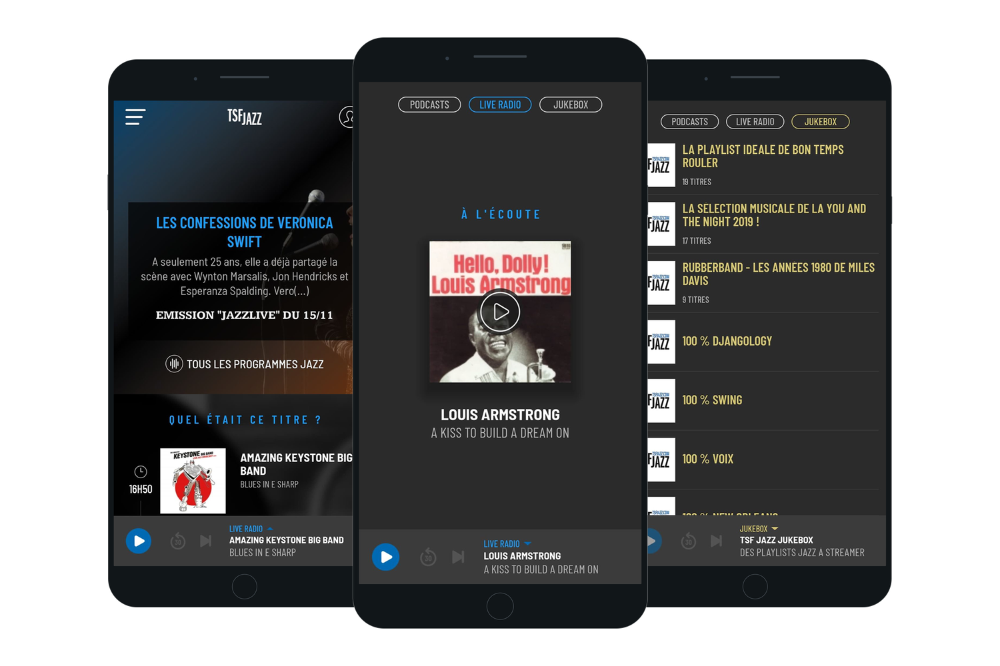
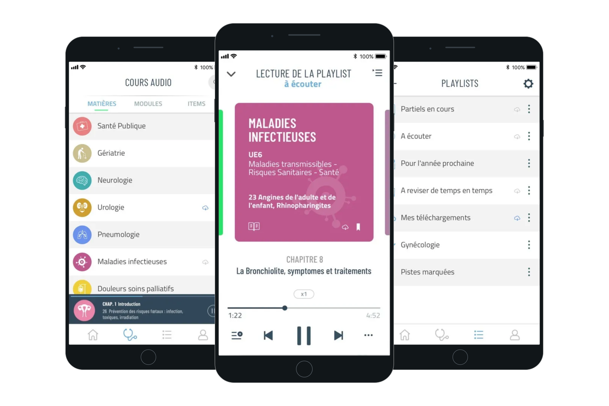
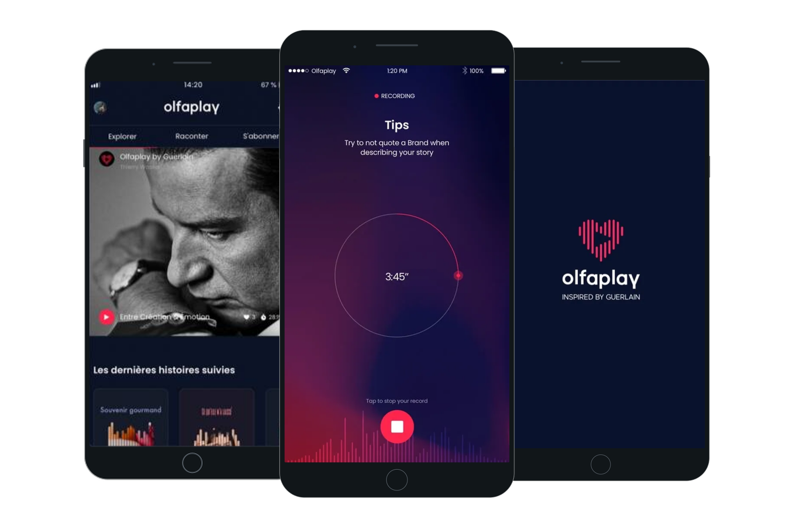
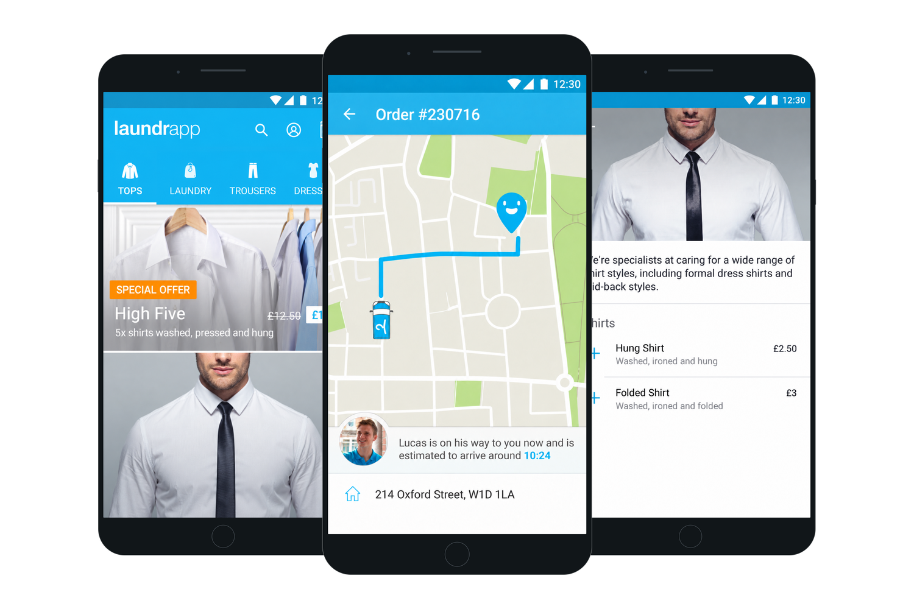
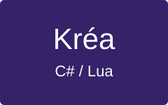

[Back to profile](../README.md) · [Labs](../labs/README.md)

# Work

Applications I have contributed to, with my role, technologies and project visuals.

<strong><a href="feel.md">Feel</a></strong> 
Mental health app. Mobile rebuild, technical leadership and Ruby on Rails backend. 
<code>React Native</code> <code>TypeScript</code> <code>Ruby on Rails</code>

 

---

<strong><a href="ooti.md">OOTI</a></strong> 
Mobile apps for architecture firms: projects, time entries, expenses and approvals. 
<code>React Native</code> <code>TypeScript</code> <code>Redux/Saga</code>

 

---

<strong><a href="sauvlife.md">Sauv’Life</a></strong> 
Mobile rebuild for volunteer responders, with geolocation and navigation. 
<code>React Native</code> <code>TypeScript</code> <code>Geolocation</code>

 

---

<strong><a href="parc-asterix.md">Parc Astérix</a></strong> 
Visitor app with maps, attractions and food services. 
<code>React Native</code> <code>TypeScript</code> <code>GraphQL</code>

 

---

<strong><a href="gametime.md">GameTime</a></strong> 
Board-game timer with Bluetooth synchronisation and game recovery. Private distribution. 
<code>Kotlin</code> <code>Android</code> <code>Bluetooth</code>

 

---

<strong><a href="hoop-hook.md">Hoop Hook</a></strong> 
Connected basketball app with sensor pairing and several game modes. 
<code>Kotlin</code> <code>Android</code> <code>BLE</code>

 

---

<strong><a href="oopet-love.md">OOPET Love</a></strong> 
Community app for pet owners, with profiles, messaging and media sharing. 
<code>Kotlin</code> <code>Android</code> <code>Firebase</code>

 

---

<strong><a href="samsung-watch-retail.md">Samsung Watch Retail</a></strong> 
In-store Galaxy Watch demo app, with kiosk mode and session reset. 
<code>Kotlin</code> <code>Android</code> <code>Kiosk mode</code>

 

---

<strong><a href="tsf-jazz.md">TSF Jazz</a></strong> 
Live radio, podcasts and themed streams on iOS and Android. 
<code>React Native</code> <code>Audio streaming</code>

 

---

<strong><a href="ecnaudio.md">ECNAudio</a></strong> 
Audio learning for medical students, with downloads and offline listening. 
<code>React Native</code> <code>Offline audio</code>

 

---

<strong><a href="olfaplay.md">Olfaplay</a></strong> 
Mobile contributions to Guerlain’s audio storytelling platform. 
<code>iOS</code> <code>Android</code> <code>Audio recording</code>

 

---

<strong><a href="laundrapp.md">Laundrapp</a></strong> 
Customer and courier Android apps for on-demand laundry services. 
<code>Android</code> <code>Java</code> <code>Google Maps</code>

 

---

<strong><a href="anaca3.md">Anaca3</a></strong> 
Maintenance of a mobile app for scanning food and viewing alternatives. 
<code>Mobile app maintenance</code>

 

---

<strong><a href="krea.md">Kréa</a></strong> 
Visual editor and Lua code generator for Corona SDK mobile projects. Support ended. 
<code>C#/.NET</code> <code>WPF</code> <code>Lua</code>

 

---

[devaxes.com](https://devaxes.com) · [LinkedIn](https://www.linkedin.com/in/freddev06/)
