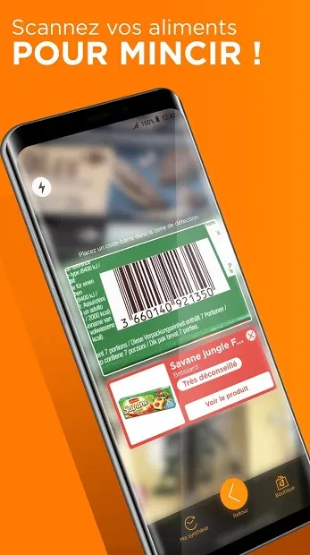
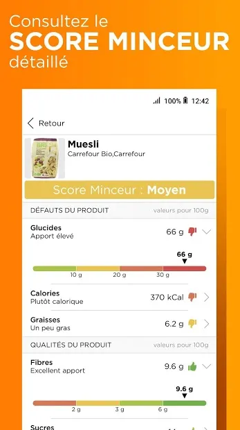
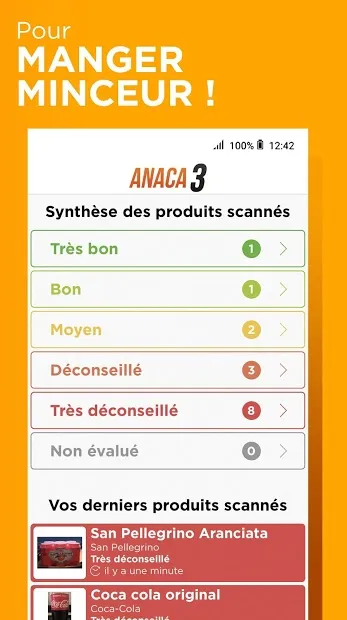
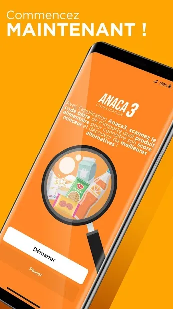

# Anaca3 - Scan minceur

Anaca3 - Scan minceur was a mobile app for checking food products. Users scanned a product's barcode to display a nutrition score and alternatives.

## My work

At Big Boss Studio, I maintained this existing app.

## Stack

`mobile app maintenance`

## Screenshots

    

---

<a href="README.md">All mobile projects</a>

