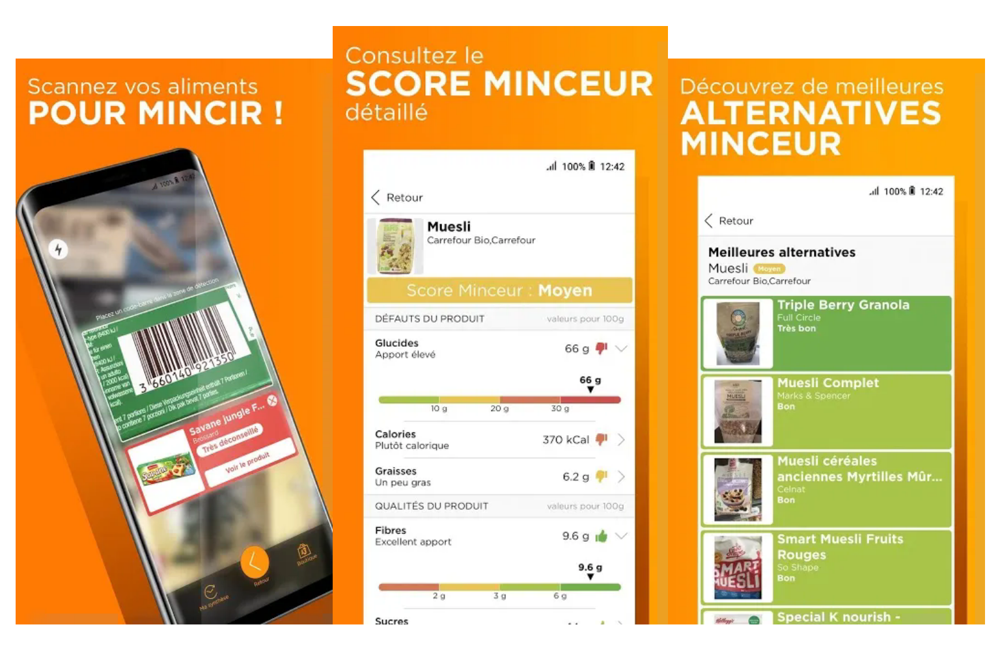
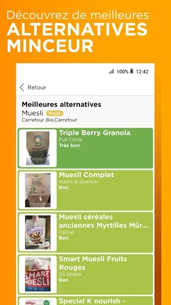

[Back to profile](../README.md) · [All work](README.md) · [Labs](../labs/README.md)

# Anaca3 - Scan minceur

Anaca3 - Scan minceur was a mobile app for checking food products. Users scanned a product's barcode to display a nutrition score and alternatives.

## My work

At Big Boss Studio, I maintained this existing app.

## Stack

`mobile app maintenance`

## Gallery

  

 

---

[devaxes.com](https://devaxes.com) · [LinkedIn](https://www.linkedin.com/in/freddev06/)
