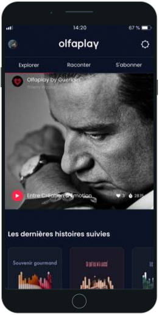
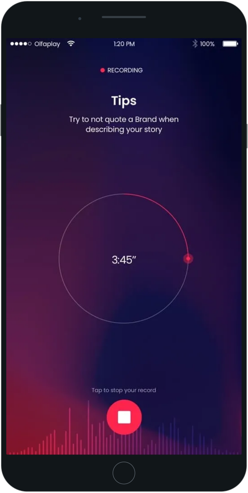
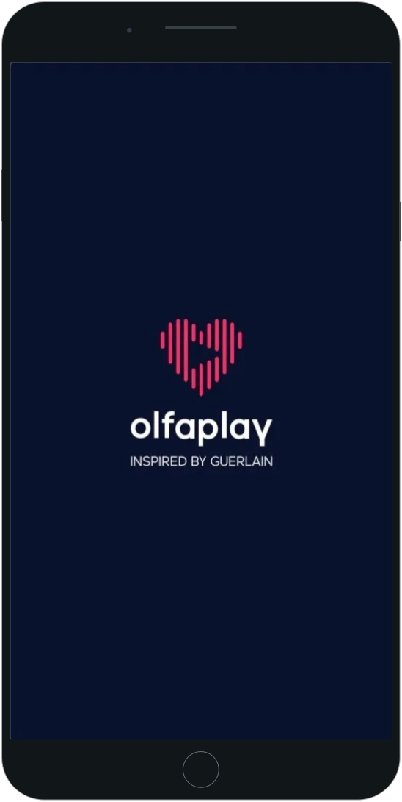
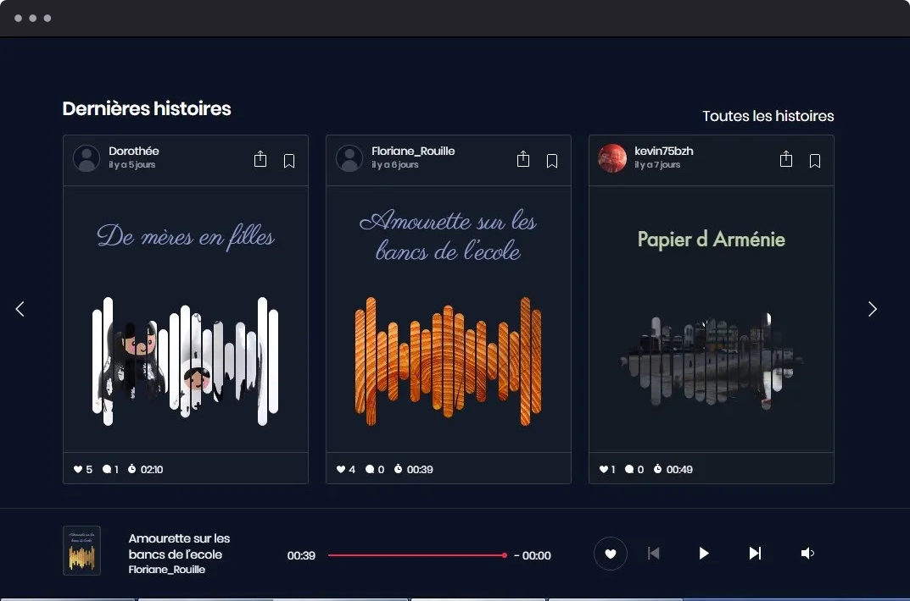

[Back to profile](../README.md) · [All work](README.md) · [Labs](../labs/README.md)

# Olfaplay

Olfaplay was an audio-story platform conceived by Guerlain around memories associated with scents. Users could record a story, give it a title and an image, then submit it for moderation before publication. Published stories could be streamed, liked and commented on; users could also follow accounts and explore content by mood or scent family. The product existed on mobile and the web. Its public launch took place in December 2018.

## My work

From March to November 2018, I contributed to the iOS and Android mobile apps at Big Boss Studio, a vendor on the project. I worked on audio recording flows, streaming audio playback, filters and integration with the moderation system. This contribution concerned the version delivered for the public launch in December 2018.

## Stack

`mobile development` `iOS` `Android` `audio recording` `audio streaming`

**Period:** March 2018 – November 2018.

## Gallery

  

---

[devaxes.com](https://devaxes.com) · [LinkedIn](https://www.linkedin.com/in/freddev06/)
