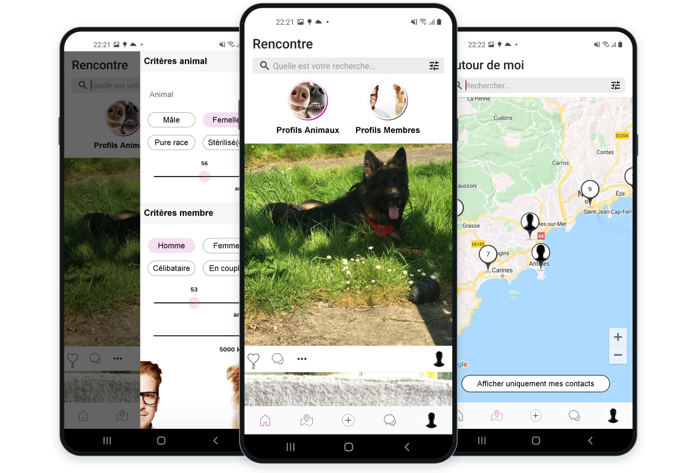
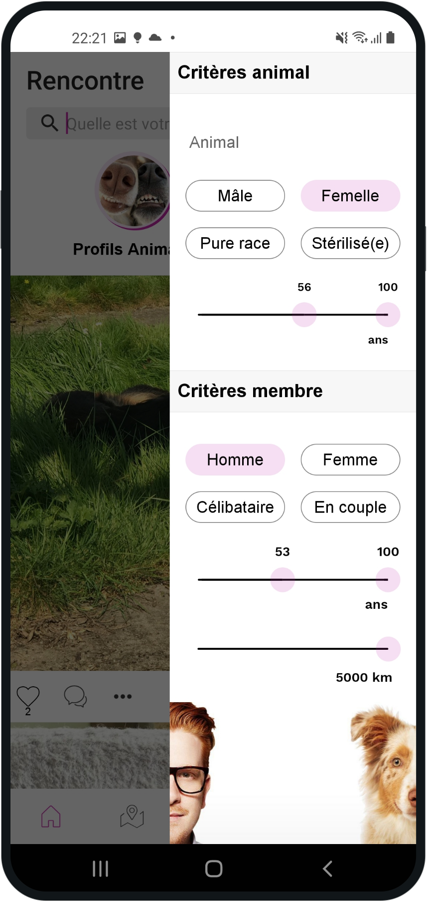
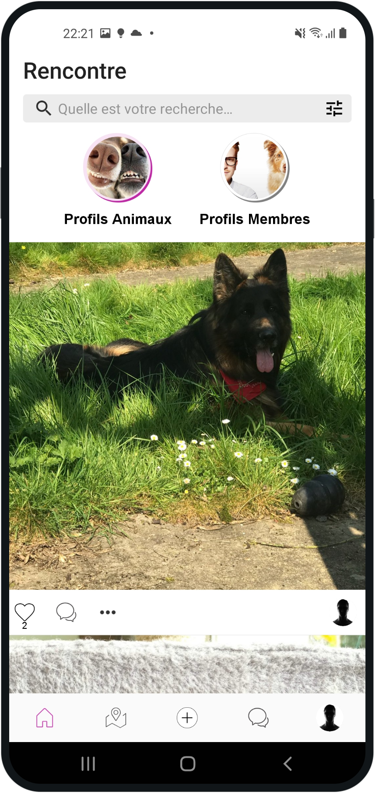
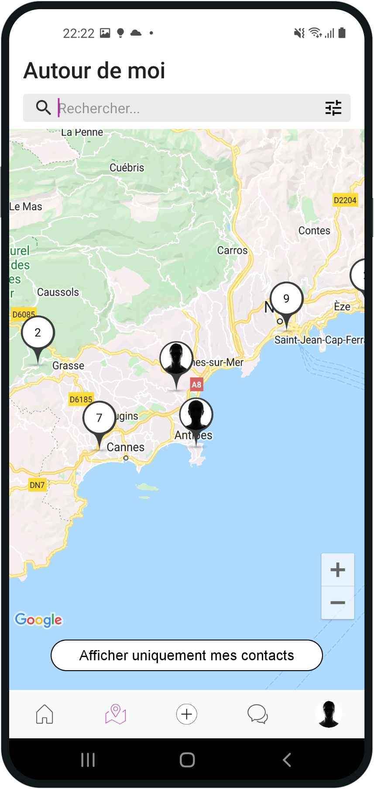
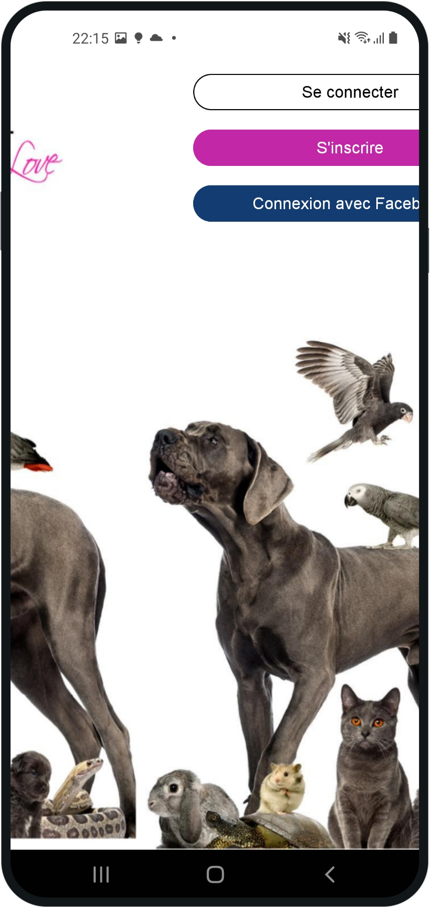
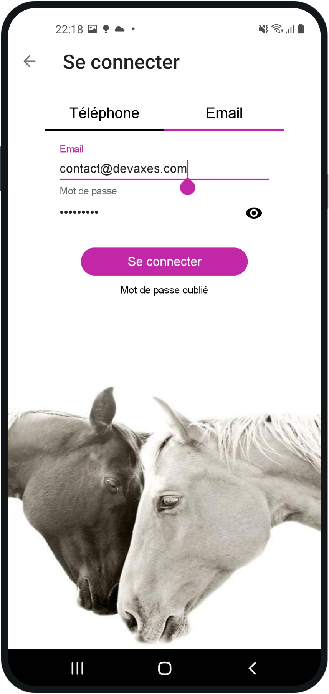

[Back to profile](../README.md) · [All work](README.md) · [Labs](../labs/README.md)

# OOPET Love

OOPET Love is a social Android app centred on pets and their owners. It brings together profiles and interactions, messaging, and tools for selecting and sharing photos and videos. The project belonged to a set of products for the same client: OOPET Love and OOPET Lost are two distinct apps that shared a common Kotlin library.

## My work

I worked on the Android app in Kotlin, particularly messaging, photo and video media management, the media selection component and app versioning.

## Stack

`Kotlin` `Android Jetpack` `mobile messaging` `media management` `Firebase`

## Gallery

  

 

---

[devaxes.com](https://devaxes.com) · [LinkedIn](https://www.linkedin.com/in/freddev06/)
