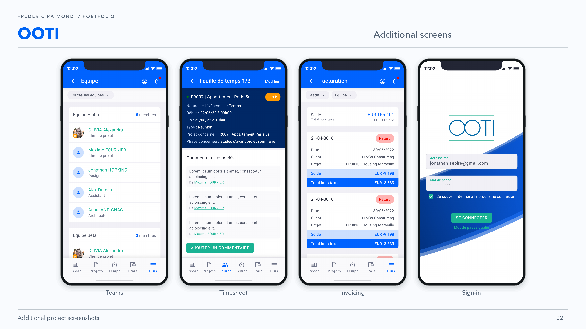

# OOTI

OOTI is an ERP for architecture firms. Its mobile app supports tasks also performed away from the office: tracking projects, recording time, entering expenses and supporting documents, reviewing invoices or handling approvals. These data then feed project management and profitability.

## My work

I worked as a Senior Mobile Developer from June 2022 to January 2023 to take over and rebuild the iOS and Android apps. I established the React Native and TypeScript architecture, navigation and components, then developed project, time, expense, invoice and approval workflows connected to a REST API. Business state was persisted locally and synchronised with that API. I also worked on authentication, permissions, adding supporting documents and CI/CD pipelines with Fastlane and Bitrise for mobile deliveries.

## Stack

React Native · TypeScript · Redux/Saga · REST API · mobile CI/CD

**Period:** June 2022 – January 2023.

## Screenshots

---

