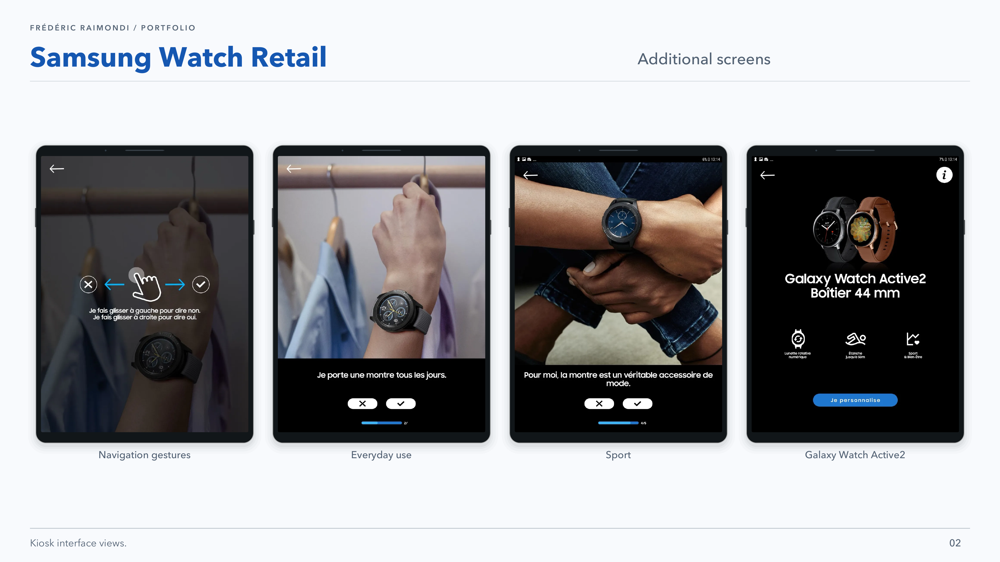

# Samsung Watch Retail

Samsung Watch Retail is an Android demonstration app installed on a retail kiosk. It allowed visitors to explore Galaxy Watch customisation options, particularly watch faces and straps. In this context, the app had to remain available for unsupervised public use: it ran in kiosk mode and returned to its initial state between visits, so that each person encountered a fresh demonstration.

## My work

I worked on this app at Big Boss Studio in a subcontracting context. My work concerned Android development in Kotlin and kiosk-specific constraints, particularly kiosk mode and session reset.

## Stack

`Kotlin` `Android` `kiosk mode` `session reset` `kiosk integration`

## Screenshots

---

<a href="README.md">All mobile projects</a>

